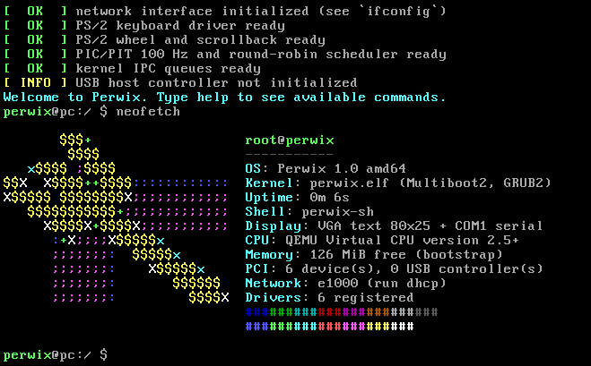

Perwix 1.2 is an experimental operating-system kernel targeting x86-64, with a separate experimental ARM64 build for QEMU.
Perwix 1.2 is not yet a general-purpose desktop operating system. Some drivers and subsystems are experimental. Detecting a device does not mean that all of its functions are supported.

Perwix 1.2 Features
Boot and Architecture
- x86-64: GRUB and Multiboot2 boot support; hybrid BIOS/UEFI ISO build.
- ARM64: a separate experimental ELF build for QEMU virt. This is not a finished port for physical ARM devices.
- Architecture-specific code is organized under kernel/arch/.
Console, Graphics, and UTF-8
- Framebuffer output supplied by the bootloader. HDMI availability depends on the graphics card, firmware, and video mode provided by GRUB/UEFI.
- Pixel bitmap font without software anti-aliasing: glyphs are drawn without scaling.
- UTF-8 decoding for shell text and filenames, limited to the glyphs available in the bundled font.
- Ukrainian and US keyboard layouts, switchable with Alt+Shift.
- Text-mode fallback.
Limitations: the framebuffer is not a universal standalone HDMI driver. Perwix cannot guarantee support for every monitor mode or every Unicode character.
ELF Modules and Commands
- Commands and some drivers are provided as separate ELF modules.
- The loader handles ELF64 and the x86-64 relocations required by the modules.
- Modules interact with the kernel through its API.
Limitations: modules execute in kernel mode (ring 0). Isolated user-mode execution in ring 3, full address-space protection, and a complete system-call model are not yet implemented.
Storage and File Systems
- Initial ATA/IDE PIO support and LBA28 sector reads.
- MBR and GPT partition-table detection.
- diskpart is a separate ELF command for inspecting disks, partitions, and volumes.
- FAT32: mounting a supported partition and reading files and directories.
- Other formats may be recognized by their signatures, but recognition does not mean they can be mounted or read.
Examples of shell commands for the available FAT32 file system:
ls
pwd
cd <directory>
cat <file>
mount
Basic diskpart commands:
diskpart help
diskpart list disk
diskpart select disk 0
diskpart detail disk
diskpart list partition
diskpart list volume
diskpart rescan
Limitations: current FAT32 and diskpart functionality is read-only. Do not use it to partition or format disks. Full SATA/AHCI, NVMe, and USB mass-storage support requires additional drivers.
Networking and USB
- kernel/net/ contains network interfaces and a polling network stack.
- kernel/drivers/ contains PCI/USB-controller detection, input, and network-adapter code.
- Experimental NIC module families include Intel e1000, Realtek RTL8139/RTL8169, VirtIO Net, AMD PCnet32, and NE2000.
- USB code performs basic detection and initial bring-up for UHCI, OHCI, EHCI, and xHCI controllers.
USB limitations: full USB transfer scheduling, device enumeration, USB HID, and USB mass storage are not yet implemented. USB4 routing/tunneling is also unsupported. Laptop input support is limited: PS/2 keyboard input is available, while USB HID and I2C-HID are not yet implemented.
Project Structure
Path	Purpose
kernel/boot/	💻 x86-64 Multiboot2 entry point
kernel/arch/x86_64/	💻 x86-64 interrupts and MMIO
kernel/arch/aarch64/	📱 Experimental ARM64 startup for QEMU
kernel/core/	Console, shell, commands, scheduler, IPC, memory allocator, and Perwix logo
kernel/drivers/	PCI, initial USB-controller support, input, and NIC drivers
kernel/net/	Network interfaces and polling network stack
kernel/fs/	VFS interfaces and file-system implementations
grub/	GRUB configuration and boot-menu artwork
tools/	Development utilities, including font generation
build.sh	💻 Build x86-64 ELF and hybrid BIOS/UEFI ISO
build-arm64.sh	📱 Experimental ARM64 ELF build
run-qemu.ps1	💻 Run x86-64 QEMU in BIOS-style mode
run-qemu-uefi.ps1	💻 Run x86-64 QEMU with OVMF/UEFI
run-qemu-arm64.ps1	📱 Run ARM64 QEMU virt

Building Perwix 1.2
Windows + WSL Environment
The documented workflow uses Windows PowerShell 5.1 or later and Ubuntu under WSL. Keep the project in a path without non-ASCII characters to avoid encoding issues in build tools, for example:
E:\Perwix\Perwix-1.2
x86-64 Dependencies
Install the required packages in Ubuntu under WSL:
sudo apt update
sudo apt install build-essential nasm grub-common grub-pc-bin \
  grub-efi-amd64-bin xorriso mtools
Run the build from PowerShell (example for a project stored on drive E:):
wsl -d Ubuntu -- bash -lc 'cd /mnt/e/Perwix/Perwix-1.2 && chmod +x build.sh && ./build.sh'
Expected output:
build/Perwix-1.2-amd64.iso
build.sh checks for GCC, the linker, NASM, grub-mkrescue, xorriso, and the GRUB x86_64-efi modules. The code is built as freestanding x86-64 with -Wall -Wextra -Werror. Do not disable these checks to hide code errors.
Experimental ARM64 Build
The ARM64 build is a separate QEMU preview, not an x86-64 ISO or a finished port for physical ARM devices. Clang and LLD are required in the build environment.
./build-arm64.sh
Expected output:
build/arm64/perwix-arm64.elf
Testing in QEMU
After successfully building the ISO, run this from PowerShell:
.\run-qemu.ps1
By default, the script expects QEMU at:
E:\Program Files\qemu\qemu-system-x86_64.exe
If QEMU is installed elsewhere, change the $qemu value in the script. The default profile emulates Q35, xHCI, an e1000 network adapter, and user-mode networking.

For UEFI/OVMF:
.\run-qemu-uefi.ps1
If the script cannot find OVMF automatically, pass the firmware paths explicitly:
.\run-qemu-uefi.ps1 -OvmfCode 'C:\path\OVMF_CODE.fd' `
  -OvmfVars 'C:\path\OVMF_VARS.fd'
The OVMF variables file is copied to build before QEMU starts, so the original firmware template is not modified.

For ARM64 QEMU:
.\run-qemu-arm64.ps1
First Boot on Physical Hardware
Testing on physical hardware is optional. Use a spare USB drive and boot Perwix 1.2 without installing it, changing disk partitions, or editing the Windows boot configuration. Back up important data first.

For the first attempt, select Safe mode + verbose diagnostics in the GRUB menu. Record the device manufacturer and exact model, CPU architecture, firmware mode, and the last message visible on screen. A screen photo can also help with diagnosis.

A Snapdragon/ARM device cannot boot the x86-64 image. A working display does not mean that the built-in keyboard, touchpad, Wi-Fi, storage, audio, or power management will work.

Do not test experimental disk or firmware operations on a computer containing important data.
Contributing
Before making changes:
1. Read this README.md and check existing issues and pull requests.
2. For substantial changes, first describe the problem, design, target architecture, and test hardware.
3. Include the exact build and test commands and actual results in your pull request.
4. Do not include serial numbers, firmware passwords, personal files, Wi-Fi passwords, or other private information in reports.
Kernel and Driver Guidelines
- Keep kernel code freestanding: do not use the host C library, hosted OS APIs, or dynamic runtime initialization.
- Follow the -Wall -Wextra -Werror policy. Fix warnings instead of globally disabling them.
- Use fixed-width integer types for hardware structures and registers.
- Validate bounds, lengths, alignment, offsets, and address arithmetic before accessing data.
- Access MMIO through existing helper functions and account for current physical-memory mappings.
- Handle errors, status bits, and timeouts; do not wait for devices in unbounded loops.
- Keep interrupt handlers short.
- Place architecture-specific code under kernel/arch/<architecture>/.
- Do not call a driver complete merely because a PCI ID or controller class was detected. State whether the implementation only detects or resets a device, enumerates it, transfers data, or supports an actual device class.
For a new driver, include supported vendor/device IDs or class/subclass/prog-if values, a specification reference, initialization sequence, register/DMA assumptions, alignment requirements, error handling, and a test report identifying the exact QEMU device or physical hardware.
License
Refer to the repository's license file for licensing and redistribution terms. If no license file exists, do not assume a license automatically.
